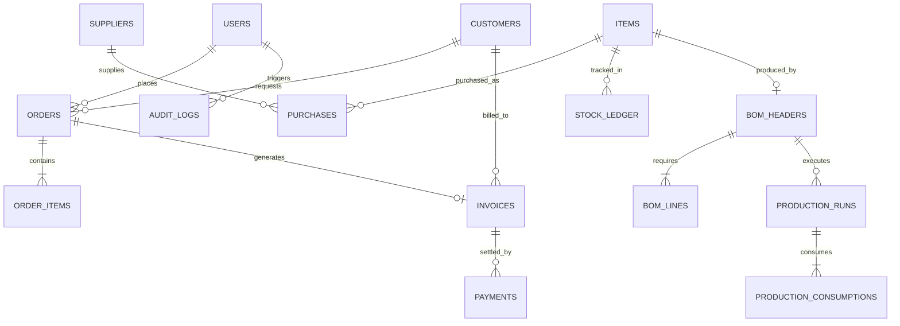

# Design Note: Order-to-Audit System

## 1. Architectural Overview
The system is architected as a **containerized modular monolith** (`FastAPI` + `MySQL 8.0` via Docker Compose) using server-side rendered Jinja2 templates styled with Tailwind CSS. This design eliminates frontend/backend state drift, ensures sub-second mobile order entry for field salesmen, and allows evaluators to run the entire stack with a single `docker compose up` command.

### Core Invariants
1. **No Floating-Point Arithmetic:** All monetary values use SQL `DECIMAL(12,2)` / Python `Decimal` with `ROUND_HALF_UP`, and all inventory quantities use `DECIMAL(12,3)` to prevent IEEE-754 rounding drift.
2. **Append-Only Stock Ledger:** The `items` table intentionally omits a `stock_qty` column. Every stock change—opening balance, purchase, production issue, production output, or sales dispatch—appends an immutable row to `stock_ledger` linked to a `source_type` and `source_id`. Current stock is always derived from the latest `balance_after`.
3. **Immutable Audit Trail:** Every state-changing transaction (purchases, production runs, overhead updates, orders, invoices, dispatches, payments) writes a timestamped, user-attributed record to `audit_logs`.

---

## 2. Entity-Relationship Diagram

---

## 3. Financial & Costing Methodology

### Inventory Valuation (Weighted Average Cost)
When a raw material purchase is recorded, the item's `current_rate` is updated using Weighted Average Cost:
$$\text{New Rate} = \frac{(\text{Existing Stock} \times \text{Old Rate}) + (\text{Purchased Qty} \times \text{Purchase Rate})}{\text{Existing Stock} + \text{Purchased Qty}}$$

*Benchmark Example:* Opening Flour is `100 kg @ ₹42.00`. Purchasing `60 kg @ ₹45.00` updates the rate to `(4200 + 2700) / 160 = ₹43.13/kg`.

### Production Variance & Cost per Packet
- **Material Variance:** Calculated on total deducted quantity (`actual_qty + damaged_qty`) vs. planned BOM quantity. Any deviation exceeding `±3.00%` sets `is_flagged = True`.
- **Yield Variance:** Calculated on `actual_output` vs. `expected_output`. Deviations exceeding `±3.00%` set `yield_flagged = True`.
- **Unit Cost:**
  $$\text{Cost per Packet} = \frac{\text{Material Cost} + \text{Labour Cost} + \text{Overhead Cost}}{\text{Actual Good Packets}}$$

### GST Determination
The factory state is configured as **Tamil Nadu**.
- **Intra-State (Customer State = Tamil Nadu):** Total GST is split equally into `CGST` and `SGST`; `IGST = 0.00`.
- **Inter-State (Customer State ≠ Tamil Nadu):** Full GST is applied as `IGST`; `CGST = 0.00`, `SGST = 0.00`.

---

## 4. Benchmark Verification Summary (Section 5)
All 9 steps are verified automatically via `tests/test_benchmark.py`:

| Step | Event | Key Verified Output |
| :--- | :--- | :--- |
| 1 | Purchase 60 kg Flour @ ₹45 | Flour Stock = `160.000 kg`, WAC = `₹43.13/kg` |
| 2 | Production Run (1 batch Murukku) | Output `188` pkts (`-6.00%` **Flagged**), Oil `10.5 L` (`+5.00%` **Flagged**), Finished Stock = `238` |
| 3–5 | Order & Dispatch: Retailer A (120 pkts, TN) | Taxable `₹6,000`, CGST `₹150`, SGST `₹150`, Total `₹6,300`; Stock = `118` |
| 6 | Order & Dispatch: Distributor B (100 pkts, KA) | Taxable `₹5,000`, IGST `₹250`, Total `₹5,250`; Stock = `18` |
| 7 | Partial Payments (₹4,000 + ₹3,675) | Receivables Due: `₹2,300` + `₹1,575` = **`₹3,875.00`** |
| 8 | Overheads (₹800 Labour + ₹400 Gas/Power) | Material `₹4,092.70` + `₹1,200` = `₹5,292.70` → **`₹28.15/packet`** |
| 9 | Audit & Exports | 15 Ledger rows, full Audit Trail, RBAC `403` enforced, PDF/Excel/CSV valid |